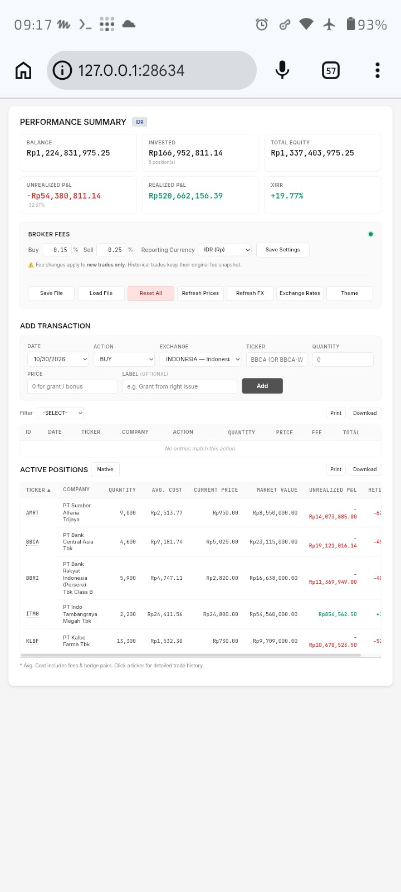
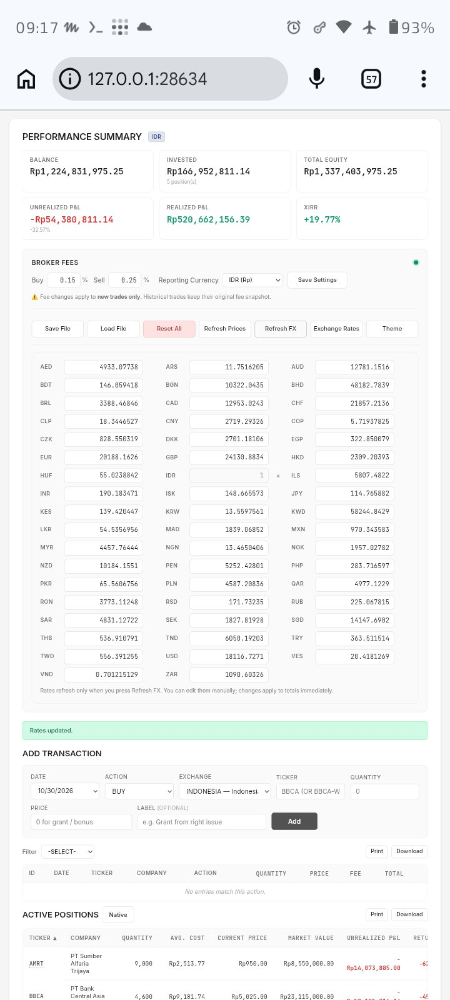
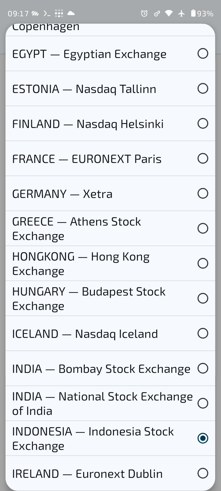
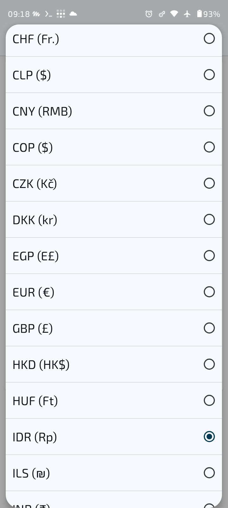

# jp004


A personal, global investment terminal for tracking stocks, cash
flows, dividends, fees, and derivatives across multiple markets and
currencies.

jp004 runs entirely on your own machine. There is no account, no
cloud database, and no order execution. A small local Python server
serves the app, proxies live market prices, and stores your journal
in a local SQLite file (`jp004.db`) next to `server.py`. Your trade
data never leaves your machine unless you explicitly export it.
When the server is unavailable, the app falls back to the browser's
`localStorage` (see [Data and privacy](#data-and-privacy)).

## Contents

- [Is jp004 for you?](#is-jp004-for-you)
- [Features](#features)
- [Coverage](#coverage)
- [Try it in two minutes](#try-it-in-two-minutes)
- [Screenshots](#screenshots)
- [Getting started](#getting-started)
- [Usage](#usage)
- [Configuration](#configuration)
- [Data and privacy](#data-and-privacy)
- [Project structure](#project-structure)
- [Server endpoints](#server-endpoints)
- [Contributing](#contributing)
- [Support](#support)
- [Security](#security)
- [License](#license)
- [Acknowledgements](#acknowledgements)
- [Disclaimer](#disclaimer)

## Is jp004 for you?

jp004 is for investors who want to track their own portfolio **without
uploading their financial records to the cloud**.

It fits you if:

- You invest across several markets and currencies and want one
  journal, not one spreadsheet per broker.
- You care about realized vs. unrealized P&L, cost basis, and XIRR,
  not just a current balance.
- You are comfortable running a small local server and keeping your
  own backups.
- You want full control over your data: export it, delete it, and
  move it yourself.

It is not for you if you want automatic broker sync, order placement,
or a hosted account. jp004 deliberately does none of those.

## Features

### Portfolio overview

- Performance summary: balance, invested capital, total equity,
  unrealized P&L, realized P&L, and XIRR, shown as plain figures
  without boxed cards.
- Multi-currency positions with a selectable reporting currency and
  editable exchange rates.
- Light and dark themes, switched from the sun/moon switch at the
  top right of the summary. The switch shows both options inside
  its track, and the choice is remembered per browser.

### Trade journal

- Transaction types: BUY, SELL, DEPOSIT, WITHDRAW, DIVIDEND, FEE,
  WARRANT, and RIGHT.
- Bonus shares and grants are recorded as zero-price buys, so they do
  not distort cash or cost basis.
- Per-ticker detail view with positions, trades, disabled trades, and
  hedge pairs.
- Position cost is calculated as a running average including fees.
  Same-day transactions are ordered chronologically, not buy-first.

### Pairing and consolidation

- **Pair:** match one buy with one sell to lock in realized P&L for
  that pair.
- **Auto Pair:** pair eligible buys and sells automatically.
- **Consolidate BUYs / SELLs:** merge multiple trades of the same
  action into a single weighted-average trade. The original trades are
  kept as disabled trades with a replacement reference, so history is
  never silently rewritten.
- **Undo:** consolidated and paired trades can be undone from the
  trade table or the ticker detail view.

### Split and reverse split

- Available in the ticker detail view when exactly one active BUY or
  SELL trade remains for that ticker and its quantity is greater than
  zero. Exercise-linked trades cannot be split.
- The original trade is disabled and replaced by a single trade with
  the new quantity and a price adjusted so that gross value, invested
  capital, cash flow, and pair P&L are unchanged. Fractional shares
  are discarded and shown in the confirmation preview.
- A split date and ratio are stored on the replacement trade for
  future charting. Closed pairs are never touched by a split.

### Prices and exchange rates

- **Refresh Prices:** one button that does both jobs, in order:
  it fetches current prices from the TradingView scanner for all
  active positions, then refreshes currency rates. The separate
  **Refresh FX** button no longer exists; it was merged into
  **Refresh Prices**.
- **Exchange Rates:** shows or hides the exchange-rate grid. The
  grid lists only the currencies you chose in Display preferences,
  plus the reporting currency; other saved rates are kept for
  calculations but not shown.
- Stablecoin rates (USDT, USDC, DAI) are refreshed from their
  TradingView pegs against USD, multiplied by the USD/IDR rate,
  and saved with the other rates.
- Broker fee defaults are Buy 0.15% and Sell 0.25%. Fee changes apply
  to new trades only; historical trades keep their original fee
  snapshot.

### Settings panel

- **⚙ Settings:** a full-width button that shows or hides the
  whole settings area (Broker Fees, the action buttons, and the
  exchange-rate grid). It starts hidden on first run; the choice
  is remembered per browser. The old chevron-only toggle is gone;
  the button now reads **Settings** with a gear icon.

### Display preferences (Customize)

- **Customize:** opens a panel where you choose exactly which
  currencies and which exchanges are shown. The panel has search
  boxes, All/None shortcuts, **Save preferences**, and
  **Reset to default**.
- What the choice filters: the Exchange dropdown, the cash
  dropdowns, the Reporting Currency dropdown, and the exchange-rate
  grid. Trades in hidden currencies or on hidden exchanges keep
  counting; they are only hidden from those lists.
- Defaults for a new browser: currencies **IDR, USD, USDT** and
  exchanges **BINANCE, XIDX, XNAS, XNYS**. Use **Reset to default**
  to return to them.
- Preferences are stored per browser (`localStorage`), not in
  `jp004.db`, so they do not travel with a database copy. Each
  browser (and each port/origin) keeps its own choice.

### Import, export, and printing

- **Save to DB / Load from DB:** in normal server mode the
  Save and Load buttons work against the SQLite database
  (`/api/db/save` and `/api/db/state`, transactional). Loading
  replaces the entire current journal, including pairs, so save
  a backup first.
- **Save File / Load File:** when the server is unavailable, the
  same buttons fall back to files — **Save File** exports the
  full journal as JSON, **Load File** imports a JSON or Excel
  (.xlsx) journal.
- **Print / Download:** print or download the positions and trades
  tables from the main view.
- **Reset All:** clears all local data. This cannot be undone except
  by loading a previously exported file.

## Coverage

All figures below are counted from `ref_table.csv` in this
repository, not estimated. Coverage means markets listed in the
reference table; it is not a fixed count of individual tickers —
any ticker listed on one of these exchanges can be tracked, with
prices fetched per ticker from the TradingView scanner.

| What | Count |
| --- | --- |
| Countries (stock markets) | 70 |
| Stock exchanges | 81 |
| Crypto exchanges (centralized, CEX) | 46 |
| Exchanges in total (`ref_table.csv` rows) | 127 |
| Currencies with exchange rates | 53 |

Notes:

- Crypto coverage is centralized exchanges only; decentralized
  exchanges (DEX) are not included. Crypto rows carry no single
  currency in the reference table because one exchange lists many
  quote currencies.
- Crypto tickers must be full pairs, for example `BTCUSDT`, not
  `BTC` alone. The quote currency of the pair (USDT, USDC, and so
  on) is what prices and cash are converted with.
- The 53 currencies are the ones with stored exchange rates
  (`fxToIDR`). Stablecoins USDT, USDC, and DAI are included in
  the currency choice and refreshed from their USD pegs.

## Try it in two minutes

A fictional sample database is included as `demo.db` (301 trades,
for illustration only). It is not loaded automatically: the database
edition starts empty. To try the demo, use a separate copy of this
repository — never your real journal folder — copy `demo.db` to
`jp004.db` there, start the server, and use **Load from DB**. Do
not copy `demo.db` over a real `jp004.db`; that would replace your
journal. Otherwise, start with your own first entries:

1. Start the server (see [Getting started](#getting-started)) and
   open `http://127.0.0.1:28634/`.
2. Add a DEPOSIT transaction for your starting cash.
3. Add a BUY transaction for a ticker you hold.
4. Press **Refresh Prices** to fetch its current price and refresh
   exchange rates.
5. Press **Save to DB** to save your journal to `jp004.db`.

That is the whole loop: enter trades, refresh prices, save often.

## Screenshots

All screenshots below show the fictional demo portfolio, not a
real portfolio.

### Performance summary and active positions



### Exchange rates



### Exchange and currency pickers





## Getting started

### Requirements

- Python 3 (tested with Python 3.12)
- A modern browser
- No API key, account, or login is required.

### Run the local server

```bash
git clone https://github.com/johnpaulandersonsinaga/jp004.git
cd jp004
python -m venv .venv
source .venv/bin/activate
pip install -r requirements.txt
python server.py
```

Then open:

```
http://127.0.0.1:28634/
```

If port 28634 is already in use, the server picks the next free port
and prints the actual URL on startup. Prefer resolving the port
conflict over accepting a new port: a different port is a different
browser origin, and browser-stored data (including display
preferences) will appear empty (see
[Data and privacy](#data-and-privacy)).

The journal itself works without the server, but live price and
exchange-rate refresh require the server to be running, because the
browser calls its `/api/price`, `/api/prices`, and `/api/db/*`
endpoints.

For agent-assisted setup, maintenance, and troubleshooting, see
[INSTRUCTIONS.md](INSTRUCTIONS.md).

## Usage

### Entering trades

Use **Add Transaction** on the main page. Choose the action, date,
ticker, quantity, and price. Cash actions (DEPOSIT, WITHDRAW, DIVIDEND,
FEE) affect the balance without creating a position. WARRANT and RIGHT
are derivative actions with their own handling.

### Pairing and consolidating

Open a ticker to see its trades. Select trades with the checkboxes to
enable **Pair** (exactly one buy and one sell) or **Consolidate**
(two or more trades of the same action). **Auto Pair** pairs eligible
trades without manual selection. Use consolidation before a split:
a split requires exactly one active trade per ticker.

### Splitting a position

Open the ticker, then use **Split / Reverse Split**. Enter the old
share count, the new share count, and the split date, then confirm the
preview. The original trade is disabled and replaced; pairs are
untouched. Use **Undo Split** to revert.

### Backups

Save with **Save to DB** after every session that changes trades,
and keep a JSON export (**Save File** in file mode) outside the
app as well. Loading replaces everything, so a backup is the only
way back from an unwanted import or a **Reset All**.

## Configuration

### Exchange reference (`ref_table.csv`)

Each row maps a market to its TradingView symbol prefix and currency:

```
country,country_code,exchange,mic,suffix_yahoo,prefix_tradingview,currency,currency_symbol
```

The file covers 127 exchanges: 81 stock exchanges across 70
countries plus 46 centralized crypto exchanges (see
[Coverage](#coverage)). The server reads the reference table from
the database first and falls back to this CSV, and loads it once at
startup, so restart the server after editing it.

### Broker fees

Fee defaults are set in the app's Broker Fees section and stored
with the journal. They apply to newly entered trades only.

## Data and privacy

- Trade data is stored primarily in the local SQLite file
  `jp004.db`, in the same folder as `server.py`. It holds the
  trades, hedge pairs, price cache, exchange rates, fees, and the
  reference table, and is created from `schema.sql` on first run
  if it does not exist yet. It is ignored by git (see
  `.gitignore`) and is never part of this repository.
- The one database exception is `demo.db`: a fictional sample
  (301 trades, verified to have no overlap with any real journal)
  published so anyone can try the app. Your own `jp004.db` is
  never committed.
- When the server is unavailable, the app falls back to the
  browser's `localStorage`, under keys such as `tj_trades_v4`,
  `tj_pairs_v4`, `tj_fx_v4`, `tj_fees_v4`, and `tj_nextseq_v4`.
  Display preferences, the theme choice, and the collapsed
  settings panel are always stored per browser in `localStorage`,
  not in the database, so they do not travel with a database copy.
- Browser-stored data is tied to the origin
  (`scheme://host:port`). Opening the app at a different host or port
  will show empty browser data. Keep the URL identical
  (`http://127.0.0.1:28634/` by default) to keep it visible.
- Personal export files (for example dated trade JSON or CSV files)
  are not part of this repository, with one exception: the fictional
  `demo.db` sample. See `.gitignore`.

## Project structure

```
jp004/
├── jp004.html        # The single-page app (HTML, CSS, JavaScript)
├── server.py         # Flask server: static files, price proxy, SQLite API
├── schema.sql        # SQLite schema for jp004.db
├── jp004.db          # Your journal database (created on first run,
│                     # ignored by git, never committed)
├── ref_table.csv     # Exchange reference: 127 exchanges (MIC, country,
│                     # TradingView prefix, currency)
├── requirements.txt  # Flask, requests
├── demo.db           # Fictional sample database (301 trades) for trying the app
├── screenshots/      # App screenshots (demo data)
├── README.md         # This file
├── LICENSE           # Apache License 2.0
├── INSTRUCTIONS.md   # Agent runbook: local setup and maintenance
├── RANCANGAN-SQLITE.md  # Design notes for the SQLite migration (Indonesian)
└── .gitignore        # Excludes personal data exports, databases, and logs
```

## Server endpoints

| Endpoint | Purpose |
| --- | --- |
| `GET /` | Serves the app (`jp004.html`) |
| `GET /api/health` | Health check, returns `{"status": "ok"}` |
| `GET /api/price?ticker=BBCA&mic=XIDX` | Single current price |
| `POST /api/prices` | Batch current prices for a list of positions |
| `GET /api/db/health` | Database health check (file, trade count) |
| `GET /api/db/state` | Full journal state from `jp004.db` |
| `GET /api/db/trades` | Trades from `jp004.db` (paged) |
| `POST /api/db/save` | Save the full journal to `jp004.db` (transactional) |

Prices come from the public TradingView scanner and may differ from a
broker's quoted prices.

## Contributing

Contributions are welcome. The usual open-source flow applies:

1. Open an issue first for anything larger than a typo, so the change
   can be discussed before code is written.
2. Fork the repository, create a focused branch, and open a pull
   request against `main`.
3. Keep pull requests small and focused on one change. A pull request
   that mixes a feature, a refactor, and a data change is hard to
   review.
4. Do not add a new dependency without discussing it in the issue
   first. jp004 intentionally has a minimal stack: vanilla
   JavaScript with no build step, plus Flask and requests on the
   server.
5. Verify before submitting: the server answers `/api/health`, the
   app loads with HTTP 200, and no personal data, export file, or
   credential is included in the change.
6. Never commit personal trade exports, logs, or backup files. The
   `.gitignore` already excludes them; do not force-add them.

Good first contributions: documentation fixes, exchange reference
corrections in `ref_table.csv`, accessibility improvements, and
additional troubleshooting entries in `INSTRUCTIONS.md`.

## Support

- **Questions and usage help:** GitHub Discussions.
- **Bugs and feature requests:** GitHub Issues, with steps to
  reproduce, the browser and Python versions, and the relevant log
  output (without any personal trade data).

## Security

If you find a security issue, do not open a public issue. Use
GitHub's private security advisory flow for this repository so the
issue can be fixed before it is disclosed.

## License

jp004 is licensed under the Apache License 2.0. See the
[LICENSE](LICENSE) file for the full text.

## Acknowledgements

- [Flask](https://flask.palletsprojects.com/) for the local server.
- [TradingView](https://www.tradingview.com/) scanner for live price
  data.

## Disclaimer

This software is provided for personal record-keeping. It is not
financial advice, and its calculations are not a substitute for a
broker's official statements. Verify realized and unrealized figures
against your broker before making investment decisions.
